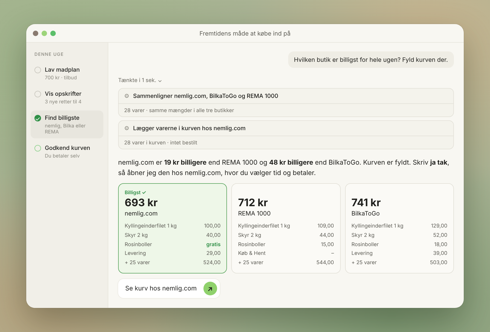
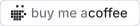

<!-- mcp-name: io.github.NJohansen/handle-mcp -->
<div align="center">


# handle-mcp

<a href="https://github.com/NJohansen/handle-mcp/stargazers"><picture><source media="(prefers-color-scheme: dark)" srcset="https://shieldcn.dev/github/NJohansen/handle-mcp/stars.svg?mode=dark"></picture></a>
<a href="https://github.com/NJohansen/handle-mcp/graphs/traffic"><picture><source media="(prefers-color-scheme: dark)" srcset="https://shieldcn.dev/badge/dynamic/json.svg?url=https%3A%2F%2Fraw.githubusercontent.com%2FNJohansen%2Fhandle-mcp%2Fbadges%2Fclones.json&query=%24.message&label=clones&mode=dark"></picture></a>
<a href="https://pypi.org/project/handle-mcp/"><picture><source media="(prefers-color-scheme: dark)" srcset="https://shieldcn.dev/pypi/handle-mcp.svg?mode=dark"></picture></a>
<a href="https://pepy.tech/projects/handle-mcp"><picture><source media="(prefers-color-scheme: dark)" srcset="https://shieldcn.dev/badge/dynamic/json.svg?url=https%3A%2F%2Fimg.shields.io%2Fpepy%2Fdt%2Fhandle-mcp.json&query=%24.message&label=downloads&mode=dark"></picture></a>
<a href="LICENSE"><picture><source media="(prefers-color-scheme: dark)" srcset="https://shieldcn.dev/badge/license-MIT-blue.svg?mode=dark"></picture></a>
<br>
<picture><source media="(prefers-color-scheme: dark)" srcset="https://shieldcn.dev/badge/platforms-macOS_%7C_Windows_%7C_Linux-blue.svg?mode=dark"></picture>

**Let your AI agent shop at [nemlig.com](https://www.nemlig.com), [BilkaToGo](https://www.bilkatogo.dk) and [REMA 1000](https://shop.rema1000.dk).**<br>
An MCP server for Claude, Grok or Codex. It reads the offers, plans the week on your budget and fills the cheapest cart. You pay.

**[Install →](#install)** · [handlemcp.dk](https://handlemcp.dk)



</div>

**It can never order or pay. You do.** That code does not exist, and a test fails if it shows up ([why](docs/adr/0001-the-human-always-pays.md)).

**It counts anonymous usage only when you say yes.** No id, no personal data. [Exactly what is sent](#usage-counts).

## How it works

1. **Plan.** Give your agent a budget. It reads this week's offers and the recipes, and plans the meals around them.
2. **Compare.** It prices the whole list in every store: pack sizes, offers, delivery fee and minimum order.
3. **Fill.** It fills the cheapest store's cart with your login. Only the cart. (At REMA 1000: your shopping list "handle-mcp".)
4. **Pay.** You open the store, check the cart, pick a delivery or pickup time and pay.

Taste, budget and meal rules live in your own prompt or skill. The server finds and counts. [Build your own skill](docs/skills.md).

## Requirements

- macOS, Linux or Windows (x64). Windows on ARM is not supported yet: a dependency (`cryptography`) has no ready-made build for it.
- [uv](https://docs.astral.sh/uv/). It fetches Python 3.12+ if you do not have it.
- An MCP client, Grok, Claude Code, Claude Desktop or Codex etc.
- An account at nemlig.com or BilkaToGo with home delivery to your address, or at REMA 1000 (Køb & Hent or shopping in the store yourself).

## Install

```sh
uvx handle-mcp@latest login nemlig
claude mcp add handle -- uvx handle-mcp@latest
```

`@latest` runs the newest release at each start. To choose when to update, use a version instead, e.g. `handle-mcp@1.5.2` ([more](docs/setup.md)).

Then ask:

- *"We have 4,000 kr a month for food. Plan this week's meals."* It asks who eats, what you like and which store, then plans on this week's offers and fills the cheapest cart after your yes.
- *"What is on offer this week? Any free gifts?"*
- *"Which delivery times are cheapest tomorrow?"*

Other stores, Claude Desktop, headless machines and AI agents (`--from-env`): [setup](docs/setup.md). nemlig's offers and REMA 1000's search work with no login. No terminal? [Join the waitlist](https://handlemcp.dk).

## Tools

| Tool | Writes? | nemlig | BilkaToGo | REMA 1000 | What |
|---|---|:-:|:-:|:-:|---|
| `search_products` | no | ✓ | ✓ | ✓ | Price, price per kg/l, offers |
| `search_recipes` | no | ✓ |  | ✓ | The store's recipes by dish |
| `list_recipes` | no | ✓ | ✓ | ✓ | Featured recipes (BilkaToGo: the week's madplan, REMA 1000: from the leaflet), by tag (nemlig, REMA 1000) or by category |
| `get_recipe` | no | ✓ | ✓ | ✓ | The products to buy for a recipe, for any number of persons (nemlig) |
| `list_offers` | no | ✓ | ✓ | ✓ | This week's offers and free gifts, also per category |
| `get_nutrition` | no | ✓ | ✓ | ✓ | Nutrition per 100 g/ml from the label |
| `compare_basket` | no | ✓ | ✓ | ✓ | Prices a list in every store, fees included, cheapest first |
| `get_cart` | no | ✓ | ✓ | ✓ | Cart lines, fees, total, in one store or every store |
| `set_cart_quantities` | **yes** | ✓ | ✓ | ✓ | Sets quantities in the cart (REMA 1000: the list "handle-mcp"). Nothing else |
| `add_recipe_to_cart` | **yes** | ✓ | ✓ | ✓ | Puts a recipe's products in the cart, after your yes. Nothing else |
| `get_delivery_info` | no | ✓ | ✓ | ✓ | Chosen time, fees |
| `list_delivery_slots` | no | ✓ | ✓ | ✓ | Free times, cheapest first (REMA 1000: Køb & Hent times) |
| `get_orders` / `get_order` | no | ✓ | ✓ |  | What you usually buy |

Full arguments and fields: [docs/tools.md](docs/tools.md).

<a name="brugsstatistik"></a>

## Usage counts

Anonymous counts, so we can see that handle-mcp is used and keep it free. The data is never sold. Only totals are shared, e.g. carts filled in a week, and totals may be shown to the stores. Off until you say yes: before that nothing is sent and no file is written. Every event has `version` and `date` (day only):

| Event | When | Fields |
|---|---|---|
| `server_started` | once a day per machine | `os` |
| `first_tool_call` | the first tool call of the day (listing tools is not a call) | `tool` |
| `login_ok` | once a day per store | `store` |
| `cart_filled` | after 30 quiet minutes, only if every line went in; then nothing until the cart is empty again | `store`, `basket_total_dkk` (nearest 50 kr), `item_count` |
| `list_filled` | the same, for REMA 1000's shopping list | `store`, `basket_total_dkk`, `item_count` |

Never sent: names, addresses, phone, email, logins, product names, order ids or any id for you or your machine. Events go to [Umami Cloud](https://umami.is) over HTTPS. Umami is a US company. It sees your IP address when an event arrives: to answer, to guess the country and to make its own visitor hash (IP, User-Agent and a salt that rotates monthly). The IP is not a field in its analytics records; Umami and its providers may keep it in operational and security logs ([Umami's privacy notice](https://umami.is/privacy)). Sends run in the background with a 2 second timeout, and a failed send never breaks a tool. Cart links carry `utm_source=handlemcp`.

You choose:

```sh
handle-mcp telemetry on      # shows what is counted, then turns it on
handle-mcp telemetry off     # the default; also deletes the saved days
handle-mcp telemetry status
```

`handle-mcp login <store>` asks once on a terminal, and Enter means no. With no terminal: `HANDLE_TELEMETRY=1`. `HANDLE_TELEMETRY=0`, `DO_NOT_TRACK=1` and `--no-telemetry` always win over a yes.

The only file is `~/.config/handle-mcp/telemetry.json`: your answer, the day each daily event was last sent, and which stores have a counted cart that is not empty yet.

Your own Umami: `HANDLE_TELEMETRY_URL` and `HANDLE_TELEMETRY_WEBSITE`. Why: [ADR 0005](docs/adr/0005-anonymous-usage-counts.md) and [ADR 0014](docs/adr/0014-usage-counts-ask-first.md).

## More

[Setup](docs/setup.md) · [Skills](docs/skills.md) · [Security](docs/security.md) · [Troubleshooting](docs/troubleshooting.md) · [Testing](docs/testing.md) · [Roadmap](docs/roadmap.md) · [Contributing](CONTRIBUTING.md) · [Credits](CREDITS.md)

Unofficial. Uses the stores' private website APIs, so it can break any day. Not affiliated with nemlig.com, Salling Group or REMA 1000.

[MIT](LICENSE)

Free, and it stays free. If it saves you time or money: <a href="https://buymeacoffee.com/niclasjohansen"></a>
